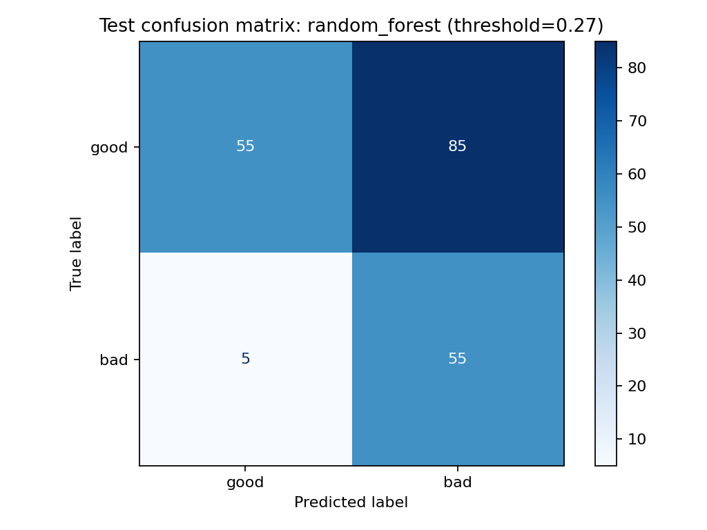
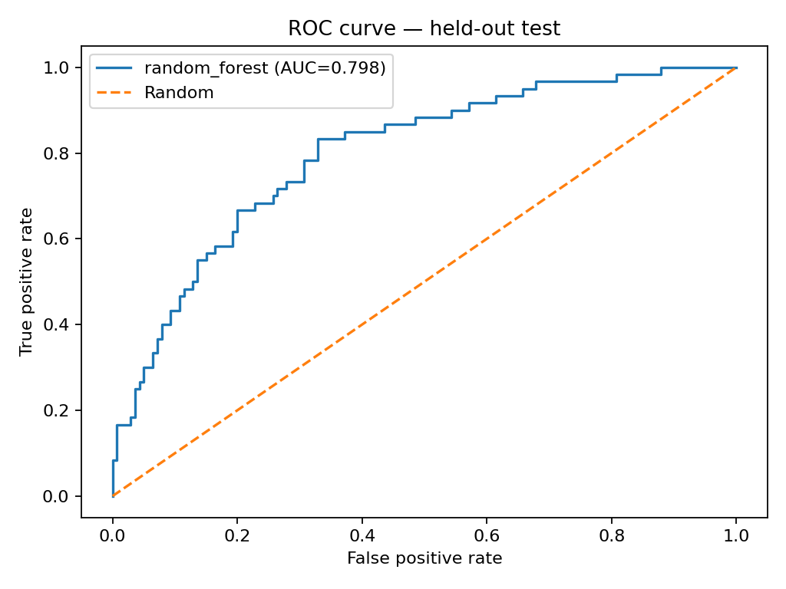
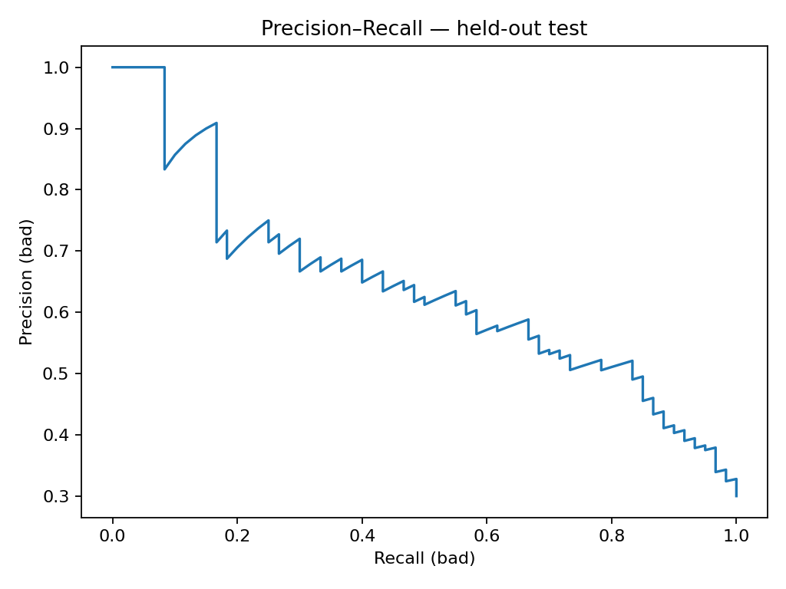
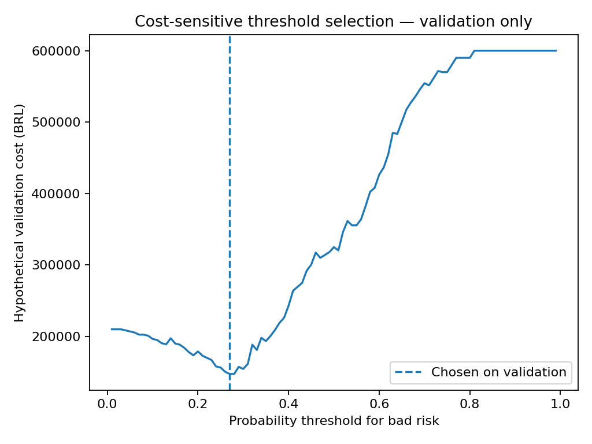
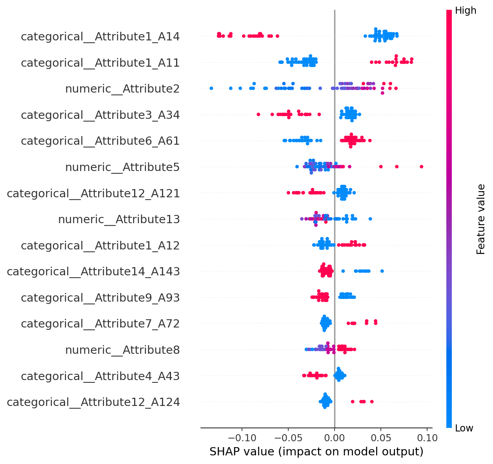

# Credit Risk Prediction | Explainable Machine Learning

A reproducible, portfolio-ready baseline for credit default prediction using the public **UCI Statlog (German Credit Data)** dataset.

## Highlights
- Data download from the UCI Machine Learning Repository (1,000 observations, 20 predictors, binary credit outcome)
- Leakage-aware stratified train/test split
- Preprocessing pipelines for numeric and categorical features
- Logistic Regression and Random Forest baselines
- ROC-AUC, average precision, confusion matrix and classification report
- Configurable decision threshold and exported metrics
- Unit tests and GitHub Actions CI

> **Note:** This is a learning portfolio project, not a production credit decision system. It does not make fairness, regulatory compliance, or deployment claims.

## Quick start

```bash
python -m venv .venv
# Windows PowerShell: .venv\Scripts\Activate.ps1
# macOS/Linux: source .venv/bin/activate
pip install -r requirements.txt
python -m src.train
pytest -q
```

The training command downloads the dataset and writes `outputs/metrics.json`, `outputs/confusion_matrix.png`, and `outputs/model.joblib`. The `outputs/` directory is gitignored.

## Dataset

UCI Machine Learning Repository, *Statlog (German Credit Data)*: https://archive.ics.uci.edu/dataset/144/statlog+german+credit+data

The dataset is fetched via `ucimlrepo`; no data or trained artifacts are committed to the repository.

## Methodology

1. Fetch and validate the dataset.
2. Convert the outcome to `1 = bad credit risk` and `0 = good credit risk`.
3. Split data with stratification before fitting preprocessors.
4. Fit and compare Logistic Regression and Random Forest on the same held-out test set.
5. Report ranking metrics and threshold-dependent metrics separately.

**Caveats:** A small historic dataset; a single held-out test split gives noisy estimates. For serious applications add cross-validation, calibration, temporal validation, fairness analysis, and cost-sensitive decision thresholds. AUC scores are not guaranteed and depend on the run.

## Structure

```text
src/data.py        # dataset retrieval and validation
src/train.py       # training, evaluation, exports
tests/             # basic automated tests
.github/workflows/ # CI
```

## Portfolio v2 — leakage-aware comparison and cost-sensitive decisions

Run `python -m src.advanced` after `pip install -r requirements.txt`. The v2 workflow uses **60% train / 20% validation / 20% held-out test**. It compares Logistic Regression, Random Forest and XGBoost (when installed), chooses the model and decision threshold **on validation only**, refits the selected model on train+validation and evaluates the test once. A lower threshold predicts more customers as bad. Hypothetical costs: R$10,000 per bad customer approved and R$1,500 per good customer rejected. These costs are illustrative, not actual financial losses.

Artifacts in `outputs_v2/`: `metrics.json`, `model.joblib`, `confusion_matrix.png`, `roc_curve.png`, `precision_recall_curve.png`, `validation_cost_curve.png`, `validation_costs.csv`, `test_predictions.csv`, and `shap_summary.png` when SHAP succeeds. The notebook `notebooks/Credit_Risk_V2_Colab.ipynb` runs the project in Colab. **Upload the updated repository before running the notebook**, as it clones GitHub.

The earlier R$177,000 estimate used a different training/evaluation procedure. **Do not compare it as a measured improvement** with v2 costs; compare v2 threshold 0.50 and v2 selected threshold on the same held-out test set. No production claims.


## Verified experiment results — v2 (held-out test)

The following results were generated by running `notebooks/Credit_Risk_V2_Colab.ipynb` on the public UCI German Credit dataset (random seed 42). The experiment uses **600 training, 200 validation and 200 test observations**. Selection of model and threshold uses validation data; the selected model is refitted on training + validation and evaluated on the held-out test set.

| Measure | Observed result |
|---|---:|
| Selected model | Random Forest |
| Test ROC-AUC | 0.7982 |
| Test average precision | 0.6421 |
| Selected probability threshold (validation) | 0.27 |
| Recall, bad-credit class at selected threshold | 91.7% |
| Precision, bad-credit class at selected threshold | 39.3% |
| Test accuracy at selected threshold | 55.0% |

### Illustrative financial decision analysis

Assumed costs: **R$10,000 per false negative** (bad credit predicted good) and **R$1,500 per false positive** (good credit predicted bad). These are hypothetical unit costs, not measured business losses. Both rows below use the **same v2 held-out test set**.

| Test-set decision threshold | False positives | False negatives | Simulated total cost |
|---|---:|---:|---:|
| 0.50 | 22 | 26 | R$ 293,000 |
| 0.27 (chosen on validation) | 85 | 5 | R$ 177,500 |

Under these assumptions, the test-set simulated cost is **39.4% lower** than at threshold 0.50 (R$ 115,500 difference). However, false positives increase from 22 to 85, reducing acceptance of good customers. The result is specific to this dataset, cost scenario and split, and is not a production or out-of-sample generalization guarantee.

### Visual evidence

**Confusion matrix at the validation-selected threshold**



**ROC curve**



**Precision–recall curve**



**Validation-set cost versus decision threshold**



**SHAP summary**



Raw reproducibility artifacts: [`metrics.json`](reports/v2/metrics.json) and [`validation_costs.csv`](reports/v2/validation_costs.csv). The serialized model and row-level test predictions are intentionally excluded from this portfolio publication.

**Limitations:** This is a small, historic educational dataset; reported estimates reflect one random split. No claim of production suitability, calibrated probabilities, fairness, regulatory compliance or external validation is made.

## Next milestones

- Cross-validation and hyperparameter tuning
- Additional interpretability checks and stability analysis
- Cost-sensitive threshold analysis
- Streamlit demonstration with synthetic sample inputs
- Model card and limitations

## License
MIT


## V3 — Probability Calibration & Statistical Validation

Version 3 has been successfully executed and evaluated
using the public UCI German Credit dataset.

### Model performance

- Selected model: Random Forest + Sigmoid Calibration
- Decision threshold: 0.17
- Test ROC-AUC: 0.7881
- Test Average Precision: 0.6047
- Default recall: 88.3%
- Test observations: 200

### Statistical validation

- Stratified bootstrap with 1,000 resamples
- ROC-AUC 95% CI: [0.7184, 0.8547]
- Average Precision 95% CI: [0.5107, 0.7247]

### Business impact simulation

- Cost at threshold 0.50: BRL 335,500
- Cost at selected threshold: BRL 182,500
- Simulated cost reduction: 45.6%

Costs are hypothetical and results are specific to
the dataset and evaluation assumptions.

### Reproducibility

Run the V3 notebook in Google Colab or execute:

    python -m src.v3

The results are available in `outputs_v3/`.
